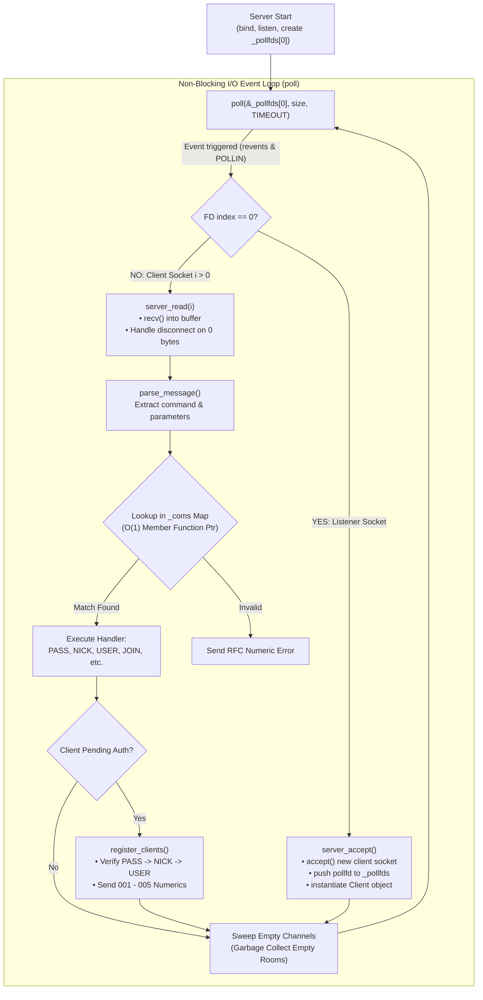
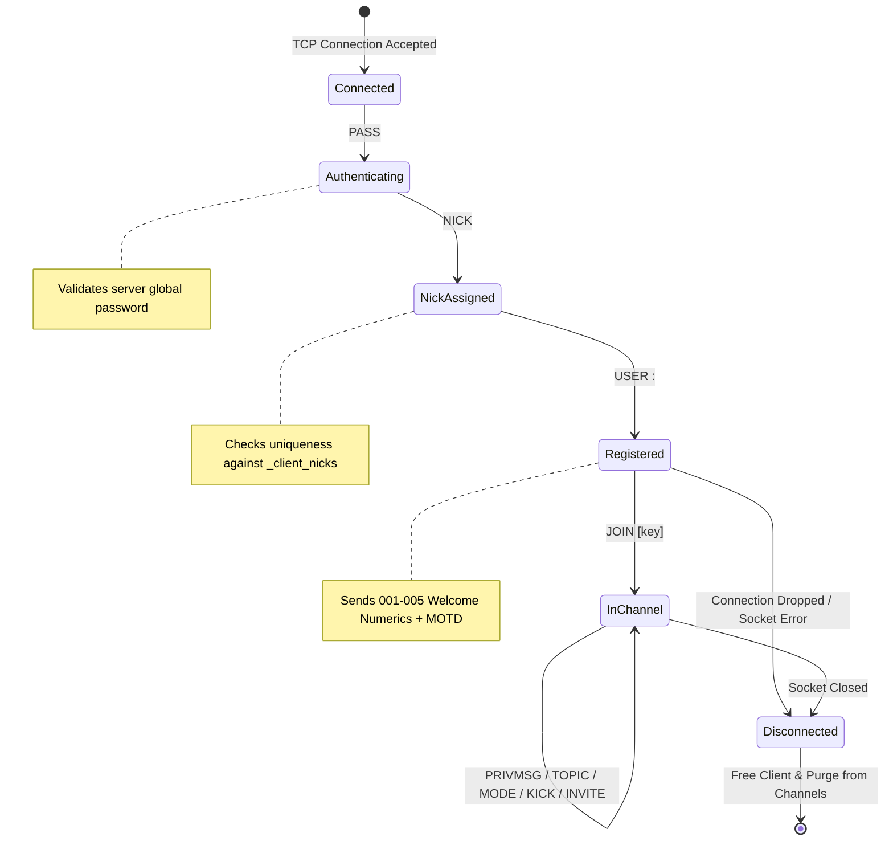

# ft_irc 📡 — Non-Blocking Concurrent IRC Server in C++98

<div align="center">

[](https://en.wikipedia.org/wiki/C%2B%2B98)
[](https://datatracker.ietf.org/doc/html/rfc2812)
[-orange?style=for-the-badge)](https://man7.org/linux/man-pages/man2/poll.2.html)
[](LICENSE)

**A high-performance, single-threaded, non-blocking Internet Relay Chat (IRC) server engineered from scratch in C++98, fully compliant with RFC 1459 and RFC 2812 standards.**

[Overview](#-overview) • [Event-Driven Architecture](#-event-driven-architecture) • [Client Lifecycle State Machine](#-client-lifecycle--rfc-handshake) • [Commands & Channel Modes](#-supported-commands--channel-modes) • [Testing & Verification](#-testing--client-connection) • [Quickstart](#-installation--compilation)

</div>

---

## 📖 Overview

**ft_irc** is a full-featured IRC network daemon developed in strict **C++98**. It provides a robust, real-time multi-user communication environment supporting private direct messages, multi-client channels, operator moderation privileges, and fine-grained channel mode enforcement.

Rather than relying on multi-threading (which introduces race conditions, lock contention, and overhead), **ft_irc** uses an **event-driven, non-blocking I/O multiplexing model** driven by the `poll()` system call. This allows hundreds of concurrent client connections to be handled synchronously in a single process with minimal memory footprint and determinism.

---

## 🏗️ Event-Driven Architecture

The core of the server runs an asynchronous event loop that monitors file descriptors (`pollfd`) for read events (`POLLIN`).



### Key Architectural Highlights:

- **Single-Threaded Asynchronous Core:** Zero thread synchronization or mutex deadlocks. CPU cache friendliness and deterministic state transitions.
- **$\mathcal{O}(1)$ Command Dispatcher:** Uses a member function pointer map (`std::map<std::string, com_fn> _coms`) to route incoming raw text tokens to member handlers in constant time.
- **Automatic Garbage Collection:** Unused or emptied channels are instantly deallocated to eliminate memory bloat.

---

## 🔄 Client Lifecycle & RFC Handshake

Clients must authenticate through a strictly ordered handshake machine before receiving server privileges.



### Standard RFC Numerics Dispatched:

| Numeric | Constant | Purpose |
| :---: | :--- | :--- |
| `001` | `RPL_WELCOME` | Confirms successful registration and displays network identity |
| `002` | `RPL_YOURHOST` | Reports host and running daemon version |
| `003` | `RPL_CREATED` | Reports server creation timestamp |
| `004` | `RPL_MYINFO` | Summary of supported user/channel modes |
| `005` | `RPL_ISUPPORT` | Advertises server limits, channel types (`#`), and mode types |

---

## 💬 Supported Commands & Channel Modes

### Core RFC 1459 / 2812 Commands

| Command | Syntax | Description |
| :--- | :--- | :--- |
| `PASS` | `PASS <password>` | Sets the connection password (must precede NICK/USER). |
| `NICK` | `NICK <nickname>` | Sets or updates user nickname with collision prevention. |
| `USER` | `USER <username> <mode> * :<realname>` | Sets user profile metadata during registration. |
| `JOIN` | `JOIN <#channel> [key]` | Joins or creates a channel; creator gets operator privileges (`+o`). |
| `PRIVMSG` | `PRIVMSG <target> :<message>` | Sends a private message to a specific user or channel room. |
| `KICK` | `KICK <#channel> <user> [comment]` | Removes a user from a channel (Operator only). |
| `INVITE` | `INVITE <user> <#channel>` | Invites a user to a channel (Required if channel is `+i`). |
| `TOPIC` | `TOPIC <#channel> [new_topic]` | Views or updates channel topic (Restricted if channel is `+t`). |
| `MODE` | `MODE <#channel> [+/-modes] [args]` | Alters channel configuration flags. |

---

### Channel Modes Implementation

Channel operators can fine-tune access control using the `MODE` command:

```ini
# Syntax: MODE <#channel> <+|-flag> [parameter]
MODE #general +k secret123      # Set password
MODE #general +l 25             # Restrict channel capacity to 25 users
MODE #general +o Alice          # Promote Alice to Channel Operator
```

| Mode Flag | Name | Parameter | Description |
| :---: | :--- | :---: | :--- |
| `+i` / `-i` | **Invite-Only** | None | Only invited users via `INVITE` can join the room. |
| `+t` / `-t` | **Topic Protection** | None | Only channel operators can alter the channel topic. |
| `+k` / `-k` | **Channel Key** | `<password>` | Sets or removes a required passphrase to enter the room. |
| `+o` / `-o` | **Operator Privilege** | `<nickname>` | Grants or revokes channel operator moderation status. |
| `+l` / `-l` | **User Limit** | `<max_users>` | Enforces a hard cap on concurrent members inside the channel. |

---

## 🧪 Testing & Client Connection

You can interact with the server using standard terminal utilities (`nc`, `telnet`) or graphical/CLI IRC clients (**irssi**, **HexChat**, **WeeChat**).

### 1. Manual Testing with Netcat (`nc`)

Run Netcat with CRLF line terminators (`-C`):

```bash
# Connect to local IRC server on port 6667
nc -C 127.0.0.1 6667
```

Paste the following handshake sequence:

```text
PASS mysecretpassword
NICK Neo
USER neo 0 * :Thomas Anderson
JOIN #matrix
PRIVMSG #matrix :Follow the white rabbit.
```

### 2. Testing with `irssi`

```bash
# Install irssi (Debian / Ubuntu)
sudo apt-get install -y irssi

# Launch irssi and connect
irssi
```

Inside `irssi`:
```text
/connect 127.0.0.1 6667 mysecretpassword Neo
/join #general
/topic #general Welcome to 42 IRC!
/mode #general +t
```

---

## 🚀 Installation & Compilation

### Requirements

- A C++ compiler supporting the **C++98** standard (`g++` or `clang++`).
- GNU Make.
- Linux / macOS operating system.

### Build the Daemon

```bash
# 1. Clone repository
git clone https://github.com/SherlockPE/Internet_Relay_Chat.git
cd Internet_Relay_Chat

# 2. Compile with strict C++98 flags (-Wall -Wextra -Werror -std=c++98)
make

# 3. Launch server on chosen port with a password
./ircserv 6667 password123
```

<details>
<summary><b>🛠️ Custom Compilation Options</b></summary>

You can configure the `poll()` timeout duration during compilation using the `tmout` parameter:

```bash
# Set poll timeout to 10000ms (10 seconds)
make tmout=10000

# Full clean rebuild
make re
```
</details>

---

## 👥 Authors

Developed at **42 Madrid**:

- **Fabricio López Reyes** ([@SherlockPE](https://github.com/SherlockPE))
- **Alejandro Bartolomé Blanco** ([@Albartol](https://github.com/albartol))